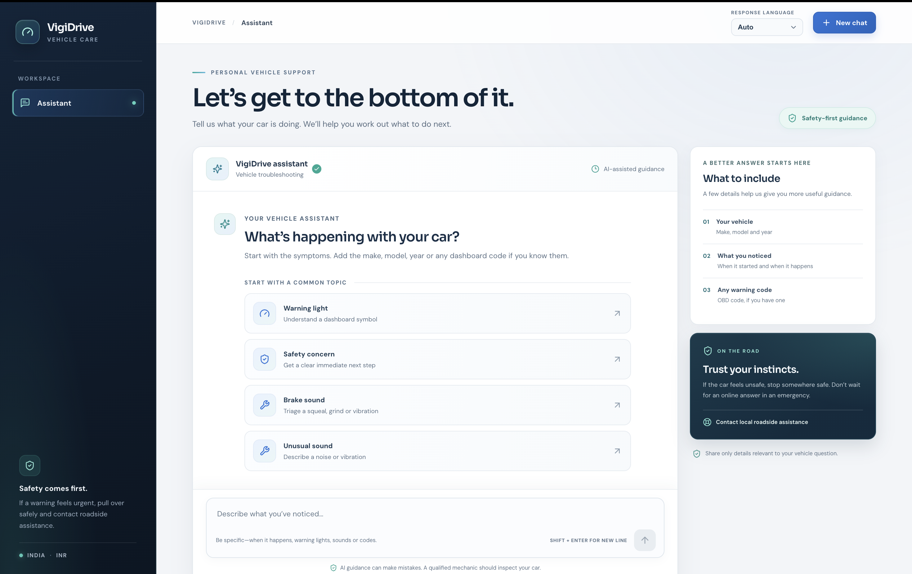
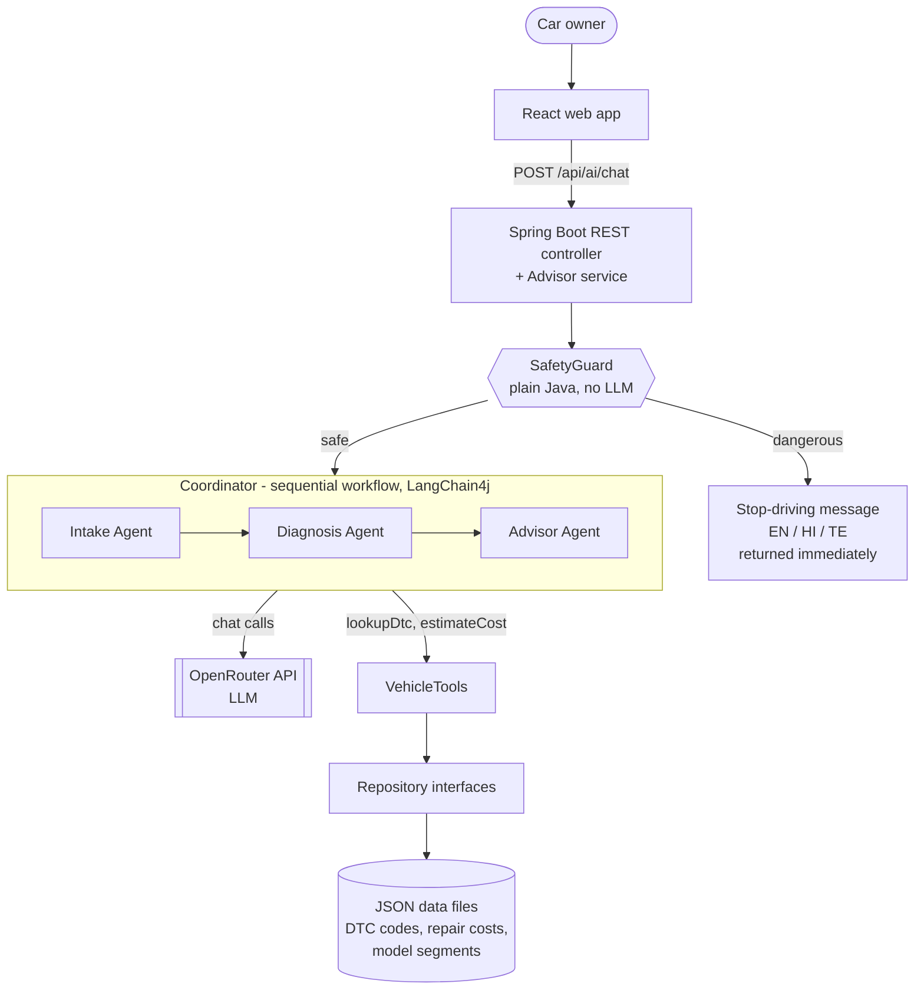

# VigiDrive

**A multi-agent vehicle assistant that tells car owners how urgent a problem is, what it may cost to fix, and what to ask the mechanic.**

Built with Java 21, Spring Boot and LangChain4j (backend), React, TypeScript and Vite (frontend), using LLMs served through [OpenRouter](https://openrouter.ai/).

<!-- TODO: replace with your real badges / links -->
[](#)
[](#)
[](#)

**Live demo:** https://vehicle-assistant-hcey.onrender.com/
*Hosted on a free tier that sleeps when idle, so the first request after a pause can take about a minute.*



> **Disclaimer:** VigiDrive gives general guidance, not a diagnosis. A qualified mechanic must inspect the car. Cost figures are estimates.

## The problem

Most car owners can't judge a mechanic's diagnosis or quote. When a warning light comes on or the car makes a strange noise, they don't know whether to stop driving now or wait until the weekend, whether a quoted price is fair, or what to ask the workshop. That leaves them anxious and open to being overcharged.

## What VigiDrive does

Describe the problem in plain words, in English, Hindi or Telugu. VigiDrive returns:

1. **Urgency:** stop now, drive carefully, service soon, or routine.
2. **Likely causes** in plain language, most likely first.
3. **An estimated repair cost range in INR** for common repairs, from published parts prices.
4. **Questions to ask your mechanic**, so you can check a quote.
5. **A clear next step.**

For dangerous symptoms (brake failure, steering loss, overheating, fuel smell, smoke, oil-pressure warning), a plain-Java safety layer answers immediately with a stop-driving message. It makes no LLM call, so the guidance is identical every time and still works if the LLM service is down.

| Example input | What happens |
|---|---|
| "Engine light is on and the car jerks when I accelerate past 60 km/h. Swift 2018." | Full pipeline: causes, urgency, INR estimate, mechanic questions. |
| "My brake pedal goes to the floor." | Safety layer answers immediately: stop driving, call a tow service. |
| "My car makes a noise." | Asks for details instead of guessing. |
| "मेरी गाड़ी स्टार्ट करने में दिक्कत कर रही है।" | Answer written in Hindi. |
| "కారు స్టార్ట్ అవ్వడానికి ఇబ్బంది పడుతోంది." | Answer written in Telugu. |

## How it works



The safety layer runs first and needs no LLM. Otherwise three LLM agents (Intake, Diagnosis, Advisor) run in a fixed sequence, using tools backed by JSON reference data. See [docs/architecture.md](docs/architecture.md) for the request flow, components and design decisions.

## Quick start

**Prerequisites:** Java 21, Maven, Node.js and npm, and an [OpenRouter](https://openrouter.ai/) API key.

**1. Start the backend** (port 8080)

```bash
git clone <YOUR-REPO-URL>
cd <YOUR-REPO-FOLDER>

export OPENROUTER_API_KEY=your-key-here      # Windows PowerShell: $env:OPENROUTER_API_KEY="your-key-here"
mvn spring-boot:run
```

**2. Start the frontend** (second terminal)

```bash
cd frontend
npm install
npm run dev
```

Open the URL Vite prints (usually `http://localhost:5173`). The dev server proxies `/api` to `http://localhost:8080`, so keep the backend running.

| Variable | Purpose |
|---|---|
<!-- TODO: use the exact variable names from your application.properties -->
| `OPENROUTER_API_KEY` | OpenRouter API key. Never commit it. |
| `OPENROUTER_MODEL` (optional) | Model ID, for example `provider/model-name`. Pick one from the [OpenRouter models list](https://openrouter.ai/models); availability changes over time. |

> **Free models are rate limited.** OpenRouter's free models have strict request limits, so you may see HTTP 429 errors under load. For real users, use a paid model with credits. Each model provider has its own data-handling policy, so check it and don't send personal data.

## Documentation

| Page | What's in it |
|---|---|
| [Architecture](docs/architecture.md) | Request flow, components, design decisions |
| [Evaluation](docs/evaluation.md) | Golden dataset, test tiers, how to run, results |
| [API](docs/api.md) | Endpoint, request and response |
| [Data](docs/data.md) | JSON reference data and price sources |
| [Deployment](docs/deployment.md) | Render setup and production build |

## Known limitations

- **Prices are estimates.** Built from published parts prices; labour is assumed in several rows, and some repairs and segments have no data. Always confirm with a mechanic.
- **Hindi and Telugu safety rules need native-speaker review.** Romanised text (for example "brake fail ayyindi") is not fully covered yet.
- **LLM availability.** OpenRouter and model-provider rate limits (HTTP 429) and outages can slow or fail requests.
- **Not a diagnosis.** The assistant cannot inspect the car.
- **Pilot status.** Early version, being tested with a small group of users.

## Roadmap

- [ ] Retry with backoff, fallback model, per-user rate limiting
- [ ] Post-diagnosis urgency check in plain Java
- [ ] Parallel Cost and Safety Review agents
- [ ] Conversation memory for follow-up questions
- [ ] MongoDB for saved vehicles and conversation history
- [ ] Real workshop quotes to replace assumed labour prices
- [ ] LLM-as-judge evaluation in CI

## Privacy

Don't enter personal information such as phone numbers or registration numbers. <!-- TODO: state what you log and store, and for how long. -->

## License

<!-- TODO: add a LICENSE file (MIT is common for portfolio projects). -->
MIT. See [LICENSE](LICENSE).

## Author

**YOUR NAME** · [LinkedIn](YOUR-LINKEDIN-URL) · [GitHub](YOUR-GITHUB-URL)
