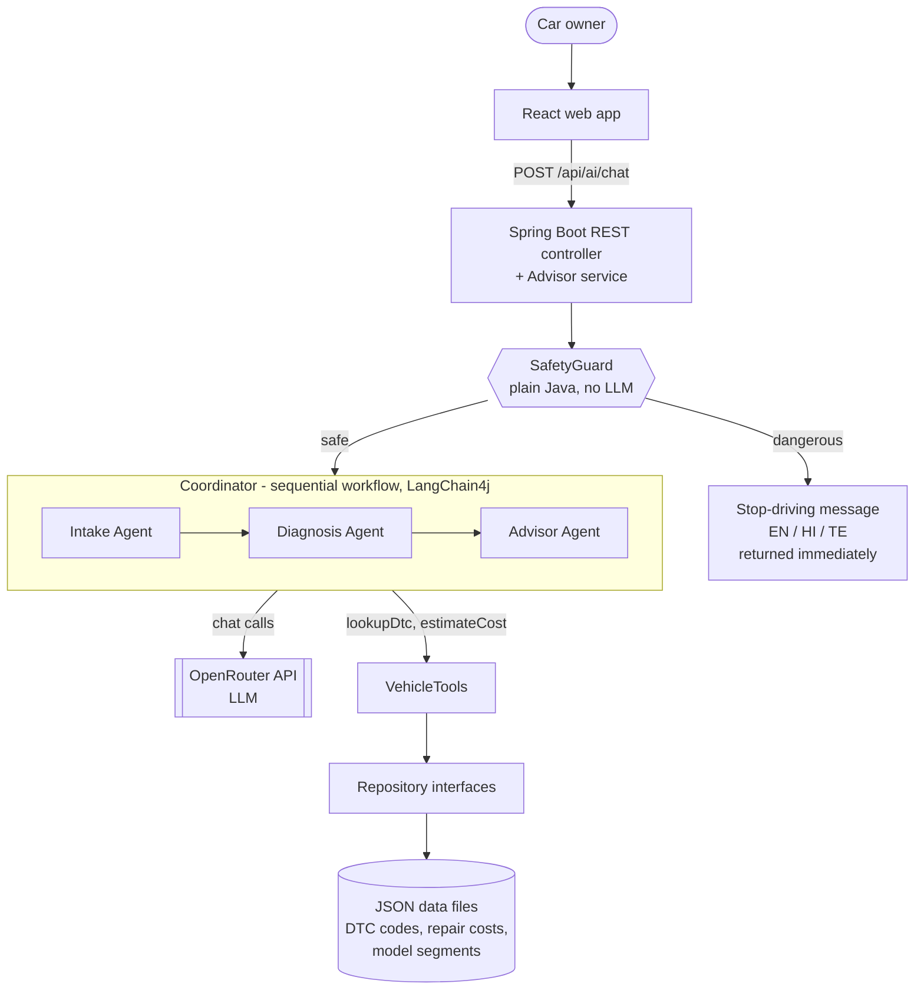
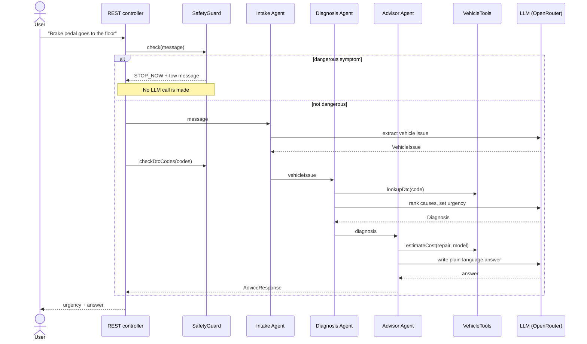

# Architecture

[← Back to README](../README.md)

## System overview

Both paths return the same `AdviceResponse` (urgency, answer, `safetyTriggered`) to the UI.

## Request flow

## Components

| Component | Responsibility |
|---|---|
| **SafetyGuard** | Plain-Java regex rules for brake failure, steering loss, overheating, fuel smell, smoke and oil pressure (English, Hindi, Telugu), plus a list of dangerous fault codes. Runs before any LLM call. |
| **Intake Agent** | LLM agent. Extracts make, model, year, symptoms and fault codes into a `VehicleIssue`. Leaves unknown fields null. |
| **Diagnosis Agent** | LLM agent. Ranks likely causes and sets urgency. Calls `lookupDtc` for fault codes. |
| **Advisor Agent** | LLM agent. Writes the final answer in the user's language: urgency, causes, cost range, mechanic questions, next step. Calls `estimateCost`. |
| **Coordinator** | Workflow orchestrator. Runs the agents in a fixed sequence and passes results through shared state. It makes no LLM call and decides nothing, by design. |
| **VehicleTools** | Tools exposed to the LLM. They depend on repository interfaces, not on the data files. |
| **Repositories** | `DtcRepository`, `RepairCostRepository`, `ModelSegmentRepository`. JSON-backed today. |

## Design decisions

- **Safety rules live outside the LLM.** For dangerous symptoms, the answer must be the same every time and must still work if the LLM service is down. `SafetyGuard` is deterministic Java and short-circuits the pipeline.
- **Tools instead of prompts for data.** Fault-code meanings and prices come from tools backed by data files. When data is missing, the tool returns an explicit "no information" message, and the prompts forbid inventing values.
- **Repository interfaces.** Reference data is read through interfaces, so the JSON files can be replaced by MongoDB or another store without changing the tools or agents.
- **Structured outputs.** Agents pass typed records (`VehicleIssue`, `Diagnosis`) with an `Urgency` enum, so urgency can't drift into free text and can be checked in tests.
- **Sequential workflow first.** Three agents plus a fixed-order coordinator are easier to debug and cheaper than a dynamic supervisor agent. No case has needed dynamic routing yet.
